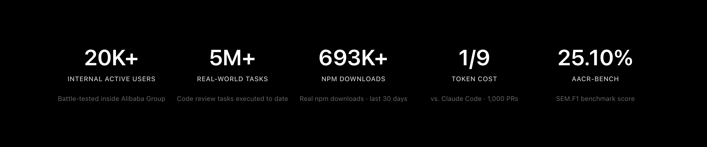
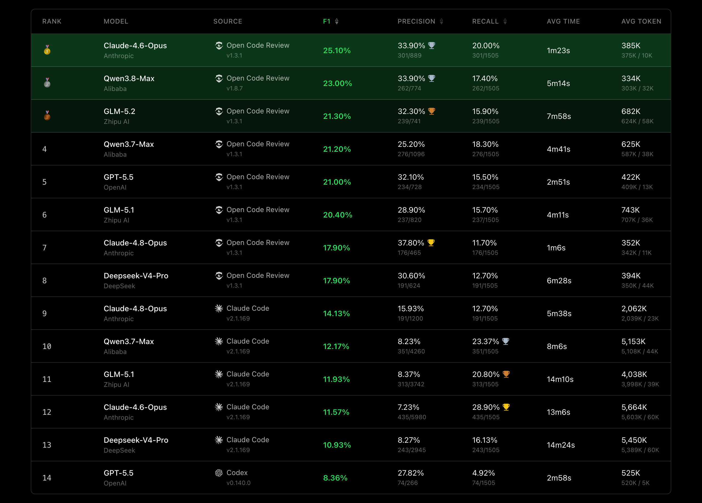
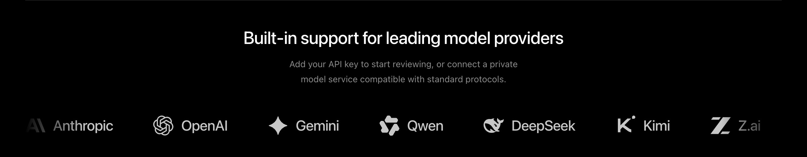

<div align="center">
  <a href="https://open-codereview.ai">
    
  </a>
  <h1>OpenCodeReview</h1>
</div>

<p align="center">
  <a href="https://trendshift.io/repositories/41087?utm_source=repository-badge&amp;utm_medium=badge&amp;utm_campaign=badge-repository-41087" target="_blank" rel="noopener noreferrer">
    
  </a>
</p>
<p align="center">
  <a href="https://trendshift.io/repositories/41087" target="_blank">
    
  </a>
  <a href="https://trendshift.io/repositories/41087" target="_blank">
    
  </a>
</p>
<p align="center">
  <a href="https://www.npmjs.com/package/@alibaba-group/open-code-review"></a>
  <a href="https://github.com/alibaba/open-code-review/actions/workflows/release.yml"></a>
  <a href="https://github.com/alibaba/open-code-review/blob/main/LICENSE"></a>
  <a href="https://deepwiki.com/alibaba/open-code-review"></a>
  <a href="https://www.bestpractices.dev/projects/13328"></a>
</p>
<p align="center">
  <a href="#supported-platforms"></a>
  <a href="#supported-platforms"></a>
  <a href="#supported-platforms"></a>
  <a href="#supported-agents"></a>
  <a href="#supported-agents"></a>
  <a href="#supported-agents"></a>
  <a href="#supported-agents"></a>
</p>
<p align="center">
  <a href="../../README.md">English</a> | <a href="README.zh-CN.md">简体中文</a> | <a href="README.ja-JP.md">日本語</a> | <a href="README.ko-KR.md">한국어</a> | <a href="README.ru-RU.md">Русский</a> | <a href="README.tr-TR.md">Türkçe</a> | <strong>Français</strong> | <a href="README.vi-VN.md">Tiếng Việt</a>
</p>

---

## Qu'est-ce que c'est Open Code Review?

Open Code Review est un outil CLI de révision de code basé sur l'IA. À l'origine, il s'agissait de l'assistant officiel de révision de code par IA utilisé en interne par le groupe Alibaba. Au cours des deux dernières années, il a aidé des dizaines de milliers de développeurs et identifié des millions de défauts de code. Après une validation approfondie à très grande échelle, nous l'avons transformé en projet open source destiné à la communauté. Il vous suffit de configurer le point d'accès au modèle pour commencer.

Il analyse les modifications entre les commits (Git diffs), envoie les fichiers modifiés à un LLM configurable via un agent doté de capacités d’utilisation d’outils, et génère des commentaires de révision structurés avec une précision au niveau de la ligne. L’agent est capable de lire l’intégralité du contenu des fichiers, d’effectuer des recherches dans la base de code, d’inspecter d’autres fichiers modifiés pour en comprendre le contexte, et de produire des révisions approfondies — et non pas seulement des commentaires superficiels sur les différences. Au-delà de la révision des différences, `ocr scan` examine l’intégralité des fichiers afin d’auditer des bases de code inconnues ou des répertoires ne présentant aucune différence significative.

Rendez-vous sur le [site officiel](https://open-codereview.ai) pour plus de détails.



## Référence

> Par rapport aux agents polyvalents (Claude Code), Open Code Review atteint des valeurs de **précision** et de **F1** nettement supérieures avec le même modèle sous-jacent, tout en ne consommant que **environ 1/9 des tokens** et en effectuant les évaluations plus rapidement. Notez que son rappel est inférieur à celui des agents polyvalents — un compromis délibéré privilégiant la précision au détriment du bruit.

Une étude comparative concrète sur la révision de code, élaborée à partir de **50** dépôts open source populaires, de **200** « Pull Requests » réelles et de **10** langages de programmation — validée de manière croisée par plus de 80 ingénieurs seniors (**1 505** tickets annotés servant de référence).

<a href="https://huggingface.co/datasets/Alibaba-Aone/aacr-bench"> Découvrez le jeu de données AACR-Bench sur Hugging Face</a>.

| Système métrique | Ce qu'il mesure | Pourquoi est-ce important ? |
|--------|-----------------|----------------|
| **F1** | Moyenne harmonique de la précision et du rappel | Meilleur chiffre unique pour évaluer la qualité globale des avis |
| **Précision** | Proportion de problèmes signalés qui constituent de véritables défauts | Plus la valeur est élevée, moins il y a de fausses alertes à trier |
| **Rappel** | Proportion de défauts réels détectés | Plus ce chiffre est élevé, moins il y a de problèmes qui échappent à la vérification |
| **Durée moyenne** | Durée réelle par évaluation | Facteurs influant sur la latence du pipeline CI |
| **Token moyen** | Nombre total de tokens utilisés par évaluation | A un impact direct sur le coût de l'API |



## Pourquoi Open Code Review?

### Le problème des agents polyvalents

Si vous avez déjà utilisé des agents polyvalents tels que Claude Code avec Skills pour la révision de code, vous avez sans doute rencontré les difficultés suivantes :

- **Couverture incomplète** — Sur les ensembles de modifications volumineux, les agents ont tendance à « prendre des raccourcis », en ne vérifiant que certains fichiers de manière sélective et en en omettant d'autres.
- **Décalage de la position** — Les problèmes signalés ne correspondent souvent pas à l'emplacement réel dans le code, les numéros de ligne ou les références de fichiers étant décalés par rapport à la cible.
- **Qualité instable** — Les compétences basées sur le langage naturel sont difficiles à déboguer, et la qualité des résultats varie considérablement en fonction de légères variations dans les invites.

La cause profonde : une architecture entièrement basée sur le langage ne prévoit pas de contraintes strictes concernant le processus de révision.

### Conception de base : ingénierie déterministe × agents hybride

La philosophie de base d'Open Code Review est de combiner l'ingénierie déterministe avec un agent, chacun gérant ce qu'il fait de mieux.

**Ingénierie déterministe — Contraintes strictes**

Pour les étapes de vérification qui *ne doivent en aucun cas présenter d'erreur*, c'est la logique technique — et non le modèle de langue — qui garantit l'exactitude :

- **Sélection précise des fichiers** — Permet de déterminer exactement quels fichiers doivent être examinés et lesquels doivent être filtrés, afin de s'assurer qu'aucune modification importante ne soit omise.
- **Regroupement intelligent de fichiers** — Regroupe les fichiers associés en une seule unité de révision (par exemple, `message_en.properties` et `message_zh.properties` sont regroupés). Chaque ensemble s'exécute en tant que sous-agent dans un contexte isolé — une stratégie de « diviser pour mieux régner » qui reste stable même avec des ensembles de modifications très volumineux et prend naturellement en charge la révision simultanée.
- **Correspondance fine des règles** — Permet de faire correspondre les règles de révision aux caractéristiques de chaque fichier, ce qui permet de maintenir l’attention du modèle parfaitement ciblée et d’éliminer le bruit informationnel à la source. Par rapport à une orientation par règles purement linguistique, la correspondance des règles basée sur un moteur de modèles est plus stable et plus prévisible.
- **Modules externes de positionnement et de réflexion** — Des modules indépendants qui placent des commentaires à des position déterminées et des éléments de reflexion améliorent systématiquement la précision de la localisation et la précision du contenu des retours fournis par l'IA.

**Agent — Prise de décision dynamique**

Les points forts de l'agent sont concentrés là où ils sont les plus importants : la prise de décisions dynamique et l'extraction dynamique de contexte :

- **Consignes adaptées à chaque scénario** — Des modèles de consignes optimisés en profondeur pour la révision de code, qui améliorent l'efficacité tout en réduisant la consommation de tokens.
- **Ensemble d'outils adapté au scénario** — Issu d’une analyse approfondie des traces d’appel des outils dans des données de production à grande échelle — notamment les distributions de fréquence des appels, les taux de répétition par outil et l’impact des nouveaux outils sur la chaîne d’appels globale —, ce qui a permis de créer une boîte à outils spécialement conçue, plus stable et plus prévisible pour la révision de code qu’une boîte à outils d’agent générique.

## Mode d'emploi

<a id="supported-platforms"></a>

### Conditions préalables

- **Git >= 2.41** — Open Code Review utilise Git pour la génération de différences, la recherche de code et les opérations sur les dépôts.
- **Système d'exploitation** : Windows, macOS ou Linux.

<a id="supported-agents"></a>

### Compétences des agents

Utilisez les compétences de Claude Code, Codex, Cursor, Kimi Code ou de tout autre agent prenant en charge les compétences d'agent et capable d'exécuter des commandes locales. Les deux modes nécessitent **Git >= 2.41** et la **`ocr` CLI** ; seul le mode natif nécessite un fournisseur de modèles pour OCR.

#### 1. Installez les compétences

Exécutez la commande depuis le répertoire du projet que vous souhaitez examiner, puis sélectionnez les compétences dont vous avez besoin ainsi que votre agent dans le programme d'installation :

```bash
npx skills add alibaba/open-code-review
```

La compétence guide votre agent pour installer `ocr` s'il n'est pas présent, sous réserve des autorisations de votre environnement. Vous pouvez également l'installer à l'avance à l'aide de `npm install -g @alibaba-group/open-code-review`. Vous préférez un plugin ou une installation manuelle ? Consultez le [Guide de configuration spécifique à l'agent](../../plugins/open-code-review/README.md), ou copiez les dossiers souhaités depuis [`skills/`](../../skills/) vers le répertoire des compétences de votre agent.

#### 2. Choisissez un mode de révision

|  | Mode natif | Mode délégation |
|---|---|---|
| Compétence | [`open-code-review`](../../skills/open-code-review/SKILL.md) | [`open-code-review-delegate`](../../skills/open-code-review-delegate/SKILL.md) |
| Qui procède à l'examen ? | L'agent d'examen spécialisé et le processus de traitement de l'OCR | Votre agent de codage actuel, conformément au processus de révision et aux mesures de contrôle de l'OCR |
| Modèle et authentification | Configuration propre à l'OCR de son fournisseur | Modèle et authentification actuels de votre agent hôte |
| Choisissez-le lorsque | Vous disposez d'un point d'accès au modèle pour l'OCR et souhaitez connaître l'intégralité de son processus de validation | Vous ne disposez pas d'une clé API distincte, ou vous souhaitez utiliser votre abonnement ou votre configuration d'agent existants |

**Vous ne disposez pas d’une clé distincte ? Commencez par le mode de délégation.** Ce mode permet d’éviter la configuration du fournisseur OCR, mais ne dispense pas de l’authentification propre à l’agent hôte, ni des limites d’utilisation, ni des coûts associés. Un abonnement à l’agent hôte ne constitue pas automatiquement un identifiant d’accès à l’API pour le mode natif. En mode délégation, l’interface CLI et la compétence de l’OCR fournissent conjointement le pipeline de révision et les garde-fous : sélection des fichiers, résolution des règles, exigences de couverture et rapports structurés. L’agent hôte effectue l’analyse, le positionnement et la génération de rapports au sein de ce flux de travail ; il n’exécute pas l’intégralité du pipeline natif de l’OCR.

Pour le mode natif, configurez un fournisseur une seule fois à l'aide de `ocr config provider` et `ocr config model`. L'authentification dépend du fournisseur ; voir [Configuration](https://open-codereview.ai/docs/configuration).

### CLI

#### Installer

```bash
npm install -g @alibaba-group/open-code-review
```

Une fois l'installation terminée, la commande `ocr` est disponible au niveau global.

Pour les autres méthodes d'installation (script d'installation, fichier binaire de la version GitHub, à partir du code source), veuillez consulter [Installation](https://open-codereview.ai/docs/installation).

#### Guide de démarrage rapide

**1. Configurer le LLM**

Vous devez configurer un LLM avant de réviser le code, sauf si vous utilisez [Mode délégation](https://open-codereview.ai/docs/delegate).

- **OCR appelle le modèle :** `ocr review`, la commande `/open-code-review:review` et la compétence `open-code-review` utilisent la configuration propre au fournisseur d'OCR, et non vos identifiants d'abonnement à Claude Code Team/Pro. Les exigences en matière d'authentification dépendent du fournisseur ; voir [Configuration](https://open-codereview.ai/docs/configuration).
- **L'agent hôte fait appel au modèle :** la commande `/open-code-review:delegate-review` et la compétence `open-code-review-delegate` utilisent le modèle et les paramètres d'authentification configurés pour l'agent hôte. Aucune configuration LLM ni aucun identifiant distinct ne sont nécessaires dans OCR. Consultez le [Étapes d'installation de Claude Code](../../plugins/open-code-review/README.md#claude-code).

```bash
ocr config provider          # Select a built-in provider or add a custom one
ocr config model             # Pick a model for the active provider
```



L'interface utilisateur interactive vous guide tout au long du processus de sélection du fournisseur, de saisie de la clé API et de configuration du modèle, puis teste automatiquement la connectivité.

Pour la configuration via l'interface en ligne de commande (CLI), les variables d'environnement, les fournisseurs personnalisés et d'autres paramètres de configuration avancés, veuillez consulter [Configuration](https://open-codereview.ai/docs/configuration).

**2. Bilan**

```bash
cd your-project

# Workspace mode — review all staged, unstaged, and untracked changes
ocr review

# Current branch — review changes since it diverged from main (--to defaults to HEAD)
ocr review --from main

# Branch range — reviews feature-branch's changes since it diverged from main (merge-base mode)
ocr review --from main --to feature-branch

# Single commit
ocr review --commit abc123

# Resume an interrupted range or commit review
ocr session list
ocr review --from main --to feature-branch --resume <session-id>

# Full-file scan — review whole files instead of a diff (no git history needed)
ocr scan                          # scan the entire repository
ocr scan --path internal/agent    # scan a directory or specific files
ocr scan --resume <session-id>   # resume an interrupted full-file scan

# Save results to a file (recommended for AI host agents)
ocr review --format json --output result.json

# Delegation mode — let your AI coding agent perform the review itself
# OCR handles file selection and rule resolution; no LLM configuration needed
ocr delegate preview
ocr delegate rule src/main.go src/handler.go
```

## Documentation

La documentation complète est disponible à l'adresse **[open-codereview.ai/docs](https://open-codereview.ai/docs)** :

- [Guide de démarrage rapide](https://open-codereview.ai/docs/quickstart) — Installez et lancez votre première révision
- [Installation](https://open-codereview.ai/docs/installation) — toutes les plateformes et tous les gestionnaires de paquets
- [Référence de l'interface en ligne de commande](https://open-codereview.ai/docs/cli-reference) — chaque commande et chaque option
- [Règles relatives aux avis](https://open-codereview.ai/docs/review-rules) — personnaliser les règles de vérification grâce au filtrage par chemin d'accès et au ciblage
- [Configuration](https://open-codereview.ai/docs/configuration) — clés de configuration et variables d'environnement
- [Serveur MCP](https://open-codereview.ai/docs/mcp) — étendre les fonctionnalités de l'agent de révision à l'aide d'outils externes
- Intégrations d'agents de codage — choisissez la plateforme que vous utilisez
  - [Claude Code](../../plugins/open-code-review/README.md#claude-code) — installer un plugin proposant des commandes « / » pour la révision
  - [Codex](../../plugins/open-code-review/README.md#codex) — installer un plugin proposant des fonctionnalités d'évaluation accessibles par appel
  - [Cursor](../../plugins/open-code-review/README.md#cursor) — installer un plugin doté de fonctionnalités de révision portables
  - [Kimi Code](../../plugins/open-code-review/README.md#kimi-code) — installer un plugin proposant des commandes de révision « slash » et des compétences
  - [OpenCode](../../plugins/open-code-review/opencode/README.md) — installer des outils de révision natifs et des commandes « slash »
  - [QCA Forward](../../plugins/open-code-review/qca/README.md) — exécuter le mode de délégation avec le modèle hôte QCA et un modèle prêt à être publié
  - [Agents compatibles avec les compétences](https://open-codereview.ai/docs/agent-skill) — installer la compétence « agent portable »
- Modes d'exécution de la révision — une fois l'intégration effectuée, choisissez quel LLM effectuera la révision
  - [Par défaut (géré par OCR)](https://open-codereview.ai/docs/configuration) — L'OCR effectue l'analyse à l'aide de son modèle de langage de grande envergure (LLM) configuré
  - [Mode délégation](https://open-codereview.ai/docs/delegate) — votre agent de codage effectue la vérification à l'aide de son propre modèle de langage de grande capacité (LLM) ; aucune clé d'API OCR n'est nécessaire
- [Intégration CI/CD](https://open-codereview.ai/docs/cicd) — Intégration avec GitHub Actions, GitLab CI, GitFlic CI et Gerrit
- [Visualiseur de session](https://open-codereview.ai/docs/viewer) — parcourez et rejouez dans le navigateur les sessions de révision enregistrées, marquez les commentaires comme « corrigés » ou « ignorés » et masquez-les pendant que vous traitez les résultats
- [Télémétrie](https://open-codereview.ai/docs/telemetry) — Intégration d'OpenTelemetry pour l'observabilité
- [FAQ](https://open-codereview.ai/docs/faq) — Questions fréquentes et dépannage

## Contribuer

Ce projet existe grâce à toutes les personnes qui y contribuent. Consultez cette page [CONTRIBUTING.md](../../CONTRIBUTING.md) pour contribuer et connaître la configuration de développement, les directives de codage et la procédure à suivre pour soumettre des pull requests.

<a href="https://github.com/alibaba/open-code-review/graphs/contributors">
  
</a>

## Licence

[Apache-2.0](../../LICENSE) — Copyright 2026 Alibaba
