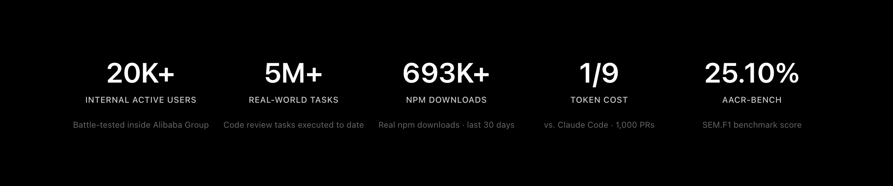
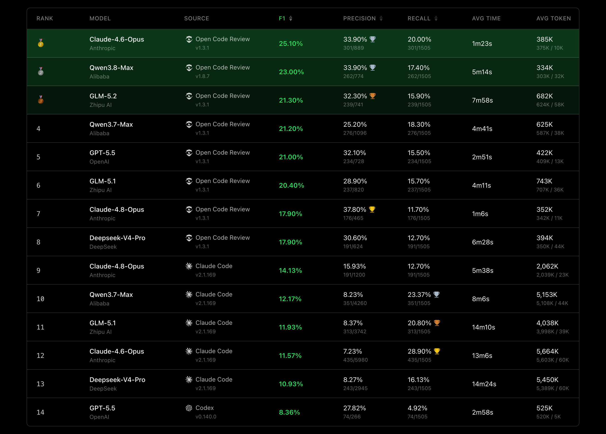
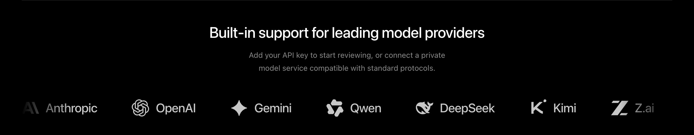

<div align="center">
  <a href="https://open-codereview.ai">
    
  </a>
  <h1>OpenCodeReview</h1>
</div>

<p align="center">
  <a href="https://trendshift.io/repositories/41087?utm_source=repository-badge&amp;utm_medium=badge&amp;utm_campaign=badge-repository-41087" target="_blank" rel="noopener noreferrer">
    
  </a>
</p>
<p align="center">
  <a href="https://trendshift.io/repositories/41087" target="_blank">
    
  </a>
  <a href="https://trendshift.io/repositories/41087" target="_blank">
    
  </a>
</p>
<p align="center">
  <a href="https://www.npmjs.com/package/@alibaba-group/open-code-review"></a>
  <a href="https://github.com/alibaba/open-code-review/actions/workflows/release.yml"></a>
  <a href="https://github.com/alibaba/open-code-review/blob/main/LICENSE"></a>
  <a href="https://deepwiki.com/alibaba/open-code-review"></a>
  <a href="https://www.bestpractices.dev/projects/13328"></a>
</p>
<p align="center">
  <a href="../../README.md#supported-platforms"></a>
  <a href="../../README.md#supported-platforms"></a>
  <a href="../../README.md#supported-platforms"></a>
  <a href="#supported-agents"></a>
  <a href="#supported-agents"></a>
  <a href="#supported-agents"></a>
  <a href="#supported-agents"></a>
</p>
<p align="center">
  <a href="../../README.md">English</a> | <a href="README.zh-CN.md">简体中文</a> | <a href="README.ja-JP.md">日本語</a> | <a href="README.ko-KR.md">한국어</a> | <a href="README.ru-RU.md">Русский</a> | Türkçe
</p>

---

## Open Code Review nedir?

Open Code Review, yapay zekâ destekli bir kod inceleme komut satırı aracıdır. Alibaba Group'un kurum içi resmî yapay zekâ kod inceleme asistanı olarak doğdu; son iki yılda on binlerce geliştiriciye hizmet verip milyonlarca kod hatası tespit etti. Büyük ölçekte kapsamlı doğrulamadan sonra topluluk için açık kaynaklı bir projeye dönüştürdük. Başlamak için bir model uç noktası yapılandırmanız yeterlidir.

Git farklarını okur, değişen dosyaları araç kullanabilen bir ajan aracılığıyla yapılandırılabilir bir büyük dil modeline (LLM) gönderir ve satır düzeyinde hassas, yapılandırılmış inceleme yorumları üretir. Ajan tüm dosya içeriğini okuyabilir, kod tabanında arama yapabilir ve bağlam için diğer değişen dosyaları inceleyebilir; böylece yalnızca yüzeysel fark yorumları değil, derinlemesine incelemeler sağlar. `ocr scan`, fark incelemesine ek olarak tanıdık olmayan kod tabanlarını veya anlamlı fark içermeyen dizinleri denetlemek için dosyaların tamamını inceler.

Ayrıntılar için [resmî web sitesini](https://open-codereview.ai) ziyaret edin.



## Karşılaştırmalı değerlendirme

> Open Code Review, aynı temel modeli kullanan genel amaçlı ajanlara (Claude Code) kıyasla belirgin biçimde daha yüksek **kesinlik (Precision)** ve **F1** elde ederken tokenların yalnızca **yaklaşık 1/9'unu** tüketir ve incelemeleri daha hızlı tamamlar. Duyarlılık (Recall) ise daha düşüktür; bu, gereksiz bildirimleri azaltıp kesinliğe öncelik veren bilinçli bir tercihtir.

**50** popüler açık kaynak deposu, **200** gerçek pull request ve **10** programlama dilinden oluşturulan gerçek dünya kod inceleme kıyaslaması; 80'den fazla kıdemli mühendis tarafından çapraz doğrulandı (**1.505** işaretlenmiş gerçek sorun).

<a href="https://huggingface.co/datasets/Alibaba-Aone/aacr-bench"> Hugging Face üzerinde AACR-Bench veri kümesini inceleyin</a>.

| Ölçüt | Neyi ölçer? | Neden önemli? |
|--------|-----------------|----------------|
| **F1** | Kesinlik ve duyarlılığın harmonik ortalaması | Genel inceleme kalitesini tek sayıyla ifade eder |
| **Precision (kesinlik)** | Bildirilen sorunlar içinde gerçek hata olanların oranı | Yüksek olması, ele alınacak yanlış alarmın azalmasıdır |
| **Recall (duyarlılık)** | Gerçek hataların bulunan kısmı | Yüksek olması, incelemeden kaçan hataların azalmasıdır |
| **Ortalama süre** | İnceleme başına geçen gerçek süre | CI işlem hattının gecikmesini etkiler |
| **Ortalama token** | İnceleme başına toplam token tüketimi | API maliyetini doğrudan etkiler |



## Neden Open Code Review?

### Genel amaçlı ajanlarla yaşanan sorunlar

Claude Code gibi genel amaçlı ajanları becerilerle kod incelemesinde kullandıysanız şu sorunlarla karşılaşmış olabilirsiniz:

- **Eksik kapsam** — Büyük değişiklik kümelerinde ajanlar işin kolayına kaçıp yalnızca bazı dosyaları inceleme ve diğerlerini atlama eğilimindedir.
- **Konum kayması** — Bildirilen sorunlar sıklıkla gerçek kod konumuyla uyuşmaz; satır numaraları veya dosya başvuruları hedeften sapar.
- **Tutarsız kalite** — Doğal dille yönlendirilen becerilerde hata ayıklamak zordur; küçük istem değişiklikleriyle inceleme kalitesi belirgin biçimde dalgalanır.

Temel neden, yalnızca dile dayanan bir mimaride inceleme sürecini sınırlayan kesin kuralların bulunmamasıdır.

### Temel tasarım: Belirlenimci mühendislik × ajan hibriti

Open Code Review, belirlenimci mühendisliği ajanla birleştirir; her biri en iyi yaptığı işi üstlenir.

**Belirlenimci mühendislik — Kesin kurallar**

*Hata yapılmaması gereken* inceleme adımlarında doğruluğu dil modeli değil, mühendislik mantığı sağlar:

- **Hassas dosya seçimi** — İncelenecek ve filtrelenecek dosyaları kesin olarak belirleyerek önemli değişikliklerin atlanmasını önler.
- **Akıllı dosya gruplama** — İlgili dosyaları tek inceleme biriminde toplar (ör. `message_en.properties` ve `message_zh.properties`). Her grup yalıtılmış bağlama sahip bir alt ajan olarak çalışır. Bu böl ve yönet yaklaşımı çok büyük değişikliklerde de kararlı kalır ve eşzamanlı incelemeyi doğal olarak destekler.
- **Ayrıntılı kural eşleştirme** — İnceleme kurallarını dosyaların özellikleriyle eşleştirerek modelin dikkatini ilgili kurallara yoğunlaştırır ve bilgi gürültüsünü kaynağında azaltır. Şablon motoruna dayalı eşleştirme, yalnızca dille yönlendirmeye göre daha kararlı ve öngörülebilirdir.
- **Harici konumlandırma ve yeniden değerlendirme modülleri** — Bağımsız yorum konumlandırma ve yorum yeniden değerlendirme modülleri, yapay zekâ yorumlarının hem konum hem içerik doğruluğunu sistematik olarak iyileştirir.

**Ajan — Dinamik karar verme**

Ajanın güçlü yanları, dinamik kararlar ve dinamik bağlam getirme üzerinde yoğunlaşır:

- **Senaryoya özel istemler** — Kod incelemesi için derinlemesine optimize edilmiş istem şablonları, etkinliği artırırken token tüketimini azaltır.
- **Senaryoya özel araç kümesi** — Büyük ölçekli üretim verilerindeki araç çağrı kayıtlarının; çağrı sıklığı dağılımları, araç başına tekrar oranları ve yeni araçların tüm çağrı zincirine etkisi dahil ayrıntılı analizinden elde edilmiştir. Kod incelemesi için özel olarak geliştirilmiş bu araç kümesi, genel amaçlı ajan araç kümelerine göre daha kararlı ve öngörülebilirdir.

## Kullanım

### Gereksinimler

- **Git >= 2.41** — Open Code Review, fark oluşturma, kod arama ve depo işlemleri için Git kullanır.

<a id="supported-agents"></a>

### Ajan becerileri

Becerileri Claude Code, Codex, Cursor, Kimi Code veya Agent Skills destekleyen ve yerel komut çalıştırabilen başka bir ajanda kullanın. Her iki mod da **Git >= 2.41** ve **`ocr` CLI** gerektirir; yalnızca yerel OCR modu bir OCR model sağlayıcısı ister.

#### 1. Becerileri kurun

İncelemek istediğiniz projede çalıştırın; kurulum aracında becerileri ve ajanınızı seçin:

```bash
npx skills add alibaba/open-code-review
```

Beceriler, ortam izinlerine bağlı olarak eksikse `ocr` kurması için ajanınızı yönlendirir. Önceden `npm install -g @alibaba-group/open-code-review` ile de kurabilirsiniz. Eklenti veya elle kurulum için [ajana özel kurulum kılavuzuna](../../plugins/open-code-review/README.md) bakın ya da [`skills/`](../../skills/) içindeki istediğiniz klasörleri ajanınızın beceri dizinine kopyalayın.

#### 2. İnceleme modunu seçin

| | Yerel OCR modu | Delege modu |
|---|---|---|
| Beceri | [`open-code-review`](../../skills/open-code-review/SKILL.md) | [`open-code-review-delegate`](../../skills/open-code-review-delegate/SKILL.md) |
| Kim inceler? | OCR'ın uzman inceleme ajanı ve işlem hattı | OCR'ın işlem hattı ve kurallarını izleyen mevcut kodlama ajanınız |
| Model ve kimlik doğrulama | OCR'ın kendi sağlayıcı ayarları | Ajan ortamınızın mevcut modeli ve kimlik doğrulaması |
| Ne zaman seçilmeli? | OCR için model uç noktanız varsa ve tam inceleme hattını istiyorsanız | Ayrı API anahtarınız yoksa veya mevcut ajan aboneliğinizi/kurulumunuzu kullanmak istiyorsanız |

**Ayrı anahtarınız yok mu? Delege moduyla başlayın.** Bu mod OCR sağlayıcı kurulumunu atlar; ajan ortamının kimlik doğrulamasını, kullanım sınırlarını veya maliyetlerini kaldırmaz. Ajan aboneliği, yerel OCR modu için otomatik olarak API kimlik bilgisi sayılmaz. Delege modunda CLI ve beceri birlikte dosya seçimi, kural çözümleme, kapsam gereksinimleri ve yapılandırılmış raporlama sağlar. Analiz, konumlandırma ve raporlamayı bu akış içinde mevcut ajan yapar; OCR'ın tam yerel işlem hattı çalışmaz.

Yerel OCR modu için `ocr config provider` ve `ocr config model` ile bir kez sağlayıcı ayarlayın. Kimlik doğrulama sağlayıcıya bağlıdır; [Yapılandırma](https://open-codereview.ai/docs/configuration) bölümüne bakın.

### CLI

#### Kurulum

```bash
npm install -g @alibaba-group/open-code-review
```

Kurulumdan sonra `ocr` komutu genel olarak kullanılabilir.

Diğer kurulum yolları (kurulum betiği, GitHub Release ikili dosyası, kaynaktan derleme) için [Kurulum](https://open-codereview.ai/docs/installation) bölümüne bakın.

#### Hızlı başlangıç

**1. LLM yapılandırması**

[Delege modunu](https://open-codereview.ai/docs/delegate) kullanmıyorsanız kod incelemeden önce bir LLM yapılandırmalısınız.

- **Modeli OCR çağırır:** `ocr review`, `/open-code-review:review` komutu ve `open-code-review` becerisi, Claude Code Team/Pro abonelik girişinizi değil OCR'ın kendi sağlayıcı ayarlarını kullanır. Kimlik doğrulama gereksinimleri sağlayıcıya bağlıdır; [Yapılandırma](https://open-codereview.ai/docs/configuration) bölümüne bakın.
- **Modeli mevcut ajan çağırır:** `/open-code-review:delegate-review` komutu ve `open-code-review-delegate` becerisi, ajan ortamının modelini ve kimlik doğrulamasını kullanır. OCR'da ayrı LLM ayarı veya kimlik bilgisi gerekmez. [Claude Code kurulumuna](../../plugins/open-code-review/README.md#claude-code) bakın.

```bash
ocr config provider          # Select a built-in provider or add a custom one
ocr config model             # Pick a model for the active provider
```



Etkileşimli arayüz sağlayıcı seçimi, API anahtarı girişi ve model ayarlarında yol gösterir, ardından bağlantıyı otomatik test eder.

CLI kurulumu, ortam değişkenleri, özel sağlayıcılar ve gelişmiş ayarlar için [Yapılandırma](https://open-codereview.ai/docs/configuration) bölümüne bakın.

**2. İnceleme**

```bash
cd your-project

# Workspace mode — review all staged, unstaged, and untracked changes
ocr review

# Geçerli dalın main'den ayrıldıktan sonraki değişikliklerini incele (--to verilmezse HEAD kullanılır)
ocr review --from main

# Branch range — reviews feature-branch's changes since it diverged from main (merge-base mode)
ocr review --from main --to feature-branch

# Single commit
ocr review --commit abc123

# Resume an interrupted range or commit review
ocr session list
ocr review --from main --to feature-branch --resume <session-id>

# Full-file scan — review whole files instead of a diff (no git history needed)
ocr scan                          # scan the entire repository
ocr scan --path internal/agent    # scan a directory or specific files
ocr scan --resume <session-id>   # resume an interrupted full-file scan

# Save results to a file (recommended for AI host agents)
ocr review --format json --output result.json

# Delegation mode — let your AI coding agent perform the review itself
# OCR handles file selection and rule resolution; no LLM configuration needed
ocr delegate preview
ocr delegate rule src/main.go src/handler.go
```

## Belgeler

Tüm belgeler **[open-codereview.ai/docs](https://open-codereview.ai/docs)** adresindedir:

- [Hızlı başlangıç](https://open-codereview.ai/docs/quickstart) — kurulum ve ilk inceleme
- [Kurulum](https://open-codereview.ai/docs/installation) — tüm platformlar ve paket yöneticileri
- [CLI başvuru kılavuzu](https://open-codereview.ai/docs/cli-reference) — tüm komutlar ve seçenekler
- [İnceleme kuralları](https://open-codereview.ai/docs/review-rules) — yol filtreleme ve hedeflemeyle kuralları özelleştirme
- [Yapılandırma](https://open-codereview.ai/docs/configuration) — ayar anahtarları ve ortam değişkenleri
- [MCP sunucusu](https://open-codereview.ai/docs/mcp) — inceleme ajanına harici araçlar ekleme
- Kodlama ajanı entegrasyonları — kullandığınız platformu seçin
  - [Claude Code](../../plugins/open-code-review/README.md#claude-code) — inceleme komutları sağlayan eklenti
  - [Codex](../../plugins/open-code-review/README.md#codex) — çağrılabilir inceleme becerileri sağlayan eklenti
  - [Cursor](../../plugins/open-code-review/README.md#cursor) — taşınabilir inceleme becerileri sağlayan eklenti
  - [Kimi Code](../../plugins/open-code-review/README.md#kimi-code) — inceleme komutları ve becerileri sağlayan eklenti
  - [OpenCode](../../plugins/open-code-review/opencode/README.md) — yerel inceleme araçları ve komutları
  - [QCA Forward](../../plugins/open-code-review/qca/README.md) — QCA modeli ve yayıma hazır şablonla delege modu
  - [Beceri uyumlu ajanlar](https://open-codereview.ai/docs/agent-skill) — taşınabilir ajan becerisini kurma
- İnceleme yürütme modları — entegrasyondan sonra modeli kimin çağıracağını seçin
  - [Varsayılan (OCR yönetiminde)](https://open-codereview.ai/docs/configuration) — incelemeyi OCR, yapılandırılmış LLM ile yürütür
  - [Delege modu](https://open-codereview.ai/docs/delegate) — incelemeyi kodlama ajanınız kendi LLM'iyle yürütür; OCR API anahtarı gerekmez
- [CI/CD entegrasyonu](https://open-codereview.ai/docs/cicd) — GitHub Actions, GitLab CI, GitFlic CI ve Gerrit
- [Oturum görüntüleyici](https://open-codereview.ai/docs/viewer) — tarayıcıda oturumları inceleyip yeniden oynatma; yorumları düzeltildi veya yok sayıldı olarak işaretleyip bulguları ele alırken gizleme
- [Telemetri](https://open-codereview.ai/docs/telemetry) — gözlemlenebilirlik için OpenTelemetry entegrasyonu
- [Sık sorulan sorular](https://open-codereview.ai/docs/faq) — yaygın sorular ve sorun giderme

## Katkıda bulunma

Bu proje katkı veren herkes sayesinde var. Geliştirme kurulumu, kodlama kuralları ve PR gönderimi için [CONTRIBUTING.md](../../CONTRIBUTING.md) dosyasına bakın.

<a href="https://github.com/alibaba/open-code-review/graphs/contributors">
  
</a>

## Lisans

[Apache-2.0](../../LICENSE) — Telif hakkı 2026 Alibaba
