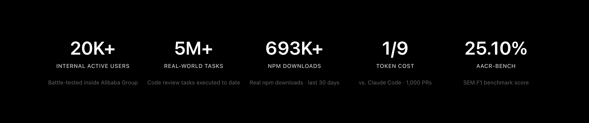
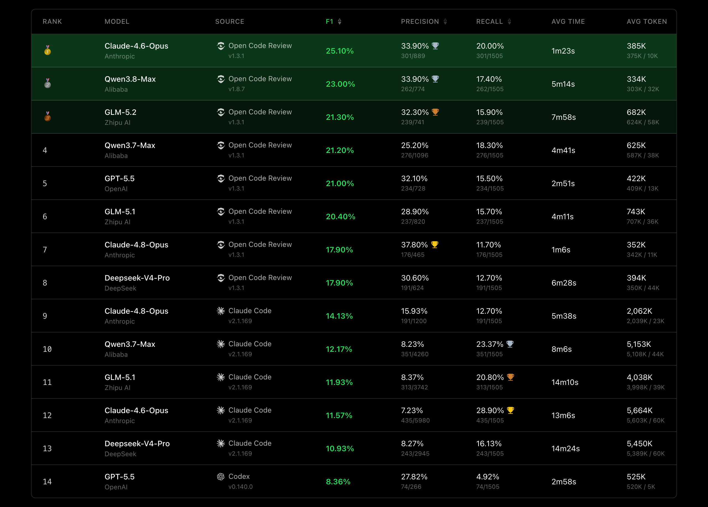

<div align="center">
  <a href="https://open-codereview.ai">
    
  </a>
  <h1>OpenCodeReview</h1>
</div>

<p align="center">
  <a href="https://trendshift.io/repositories/41087?utm_source=repository-badge&amp;utm_medium=badge&amp;utm_campaign=badge-repository-41087" target="_blank" rel="noopener noreferrer">
    
  </a>
</p>
<p align="center">
  <a href="https://trendshift.io/repositories/41087" target="_blank">
    
  </a>
  <a href="https://trendshift.io/repositories/41087" target="_blank">
    
  </a>
</p>
<p align="center">
  <a href="https://www.npmjs.com/package/@alibaba-group/open-code-review"></a>
  <a href="https://github.com/alibaba/open-code-review/actions/workflows/release.yml"></a>
  <a href="https://github.com/alibaba/open-code-review/blob/main/LICENSE"></a>
  <a href="https://deepwiki.com/alibaba/open-code-review"></a>
  <a href="https://www.bestpractices.dev/projects/13328"></a>
</p>
<p align="center">
  <a href="#supported-platforms"></a>
  <a href="#supported-platforms"></a>
  <a href="#supported-platforms"></a>
  <a href="#supported-agents"></a>
  <a href="#supported-agents"></a>
  <a href="#supported-agents"></a>
  <a href="#supported-agents"></a>
  <a href="#supported-agents"></a>
</p>
<p align="center">
  <a href="../../README.md">English</a> | <a href="README.zh-CN.md">简体中文</a> | <a href="README.ja-JP.md">日本語</a> | <a href="README.ko-KR.md">한국어</a> | <a href="README.ru-RU.md">Русский</a> | <a href="README.tr-TR.md">Türkçe</a> | <a href="README.fr-FR.md">Français</a> | Tiếng Việt
</p>

---

## Open Code Review là gì?

Open Code Review là công cụ CLI rà soát mã nguồn (code review) bằng AI. Nó khởi nguồn là trợ lý rà soát mã bằng AI chính thức dùng nội bộ tại Alibaba Group — trong hai năm qua, nó đã phục vụ hàng chục nghìn lập trình viên và phát hiện hàng triệu lỗi trong mã nguồn. Sau khi được kiểm chứng kỹ lưỡng ở quy mô lớn, chúng tôi đã ươm tạo nó thành một dự án mã nguồn mở cho cộng đồng. Chỉ cần cấu hình một đầu mối mô hình (model endpoint) là có thể bắt đầu.

Nó đọc Git diff, gửi các tệp đã thay đổi tới một LLM có thể cấu hình thông qua một agent có khả năng dùng công cụ, và tạo ra các nhận xét rà soát có cấu trúc với độ chính xác tới từng dòng. Agent có thể đọc toàn bộ nội dung tệp, tìm kiếm trong codebase, kiểm tra các tệp thay đổi khác để lấy ngữ cảnh, và đưa ra những rà soát chuyên sâu — không chỉ là phản hồi bề mặt trên diff. Ngoài rà soát diff, `ocr scan` rà soát toàn bộ tệp để kiểm toán các codebase chưa quen thuộc hoặc các thư mục không có diff đáng kể.

Truy cập [trang web chính thức](https://open-codereview.ai) để biết thêm chi tiết.



## Benchmark

> So với các agent đa năng (Claude Code), Open Code Review đạt **Precision** và **F1** cao hơn đáng kể với cùng một mô hình nền, trong khi chỉ tiêu tốn khoảng **1/9 lượng token** và hoàn thành rà soát nhanh hơn. Lưu ý rằng Recall của nó thấp hơn các agent đa năng — đây là sự đánh đổi có chủ đích, ưu tiên độ chính xác hơn là nhiễu.

Một benchmark rà soát mã trong thế giới thực được xây dựng từ **50** kho mã nguồn mở phổ biến, **200** Pull Request thật và **10** ngôn ngữ lập trình — được kiểm chứng chéo bởi hơn 80 kỹ sư cấp cao (**1.505** vấn đề ground-truth đã được chú thích).

<a href="https://huggingface.co/datasets/Alibaba-Aone/aacr-bench"> Khám phá bộ dữ liệu AACR-Bench trên Hugging Face</a>.

| Chỉ số        | Đo lường điều gì                            | Vì sao quan trọng                                      |
| ------------- | ------------------------------------------- | ------------------------------------------------------ |
| **F1**        | Trung bình điều hòa của precision và recall | Con số đơn lẻ tốt nhất cho chất lượng rà soát tổng thể |
| **Precision** | Tỷ lệ vấn đề được báo cáo là lỗi thật       | Càng cao = càng ít báo động giả phải sàng lọc          |
| **Recall**    | Tỷ lệ lỗi thật được tìm thấy                | Càng cao = càng ít vấn đề lọt qua rà soát              |
| **Avg Time**  | Thời gian thực tế cho mỗi lần rà soát       | Quan trọng với độ trễ của pipeline CI                  |
| **Avg Token** | Tổng token tiêu thụ cho mỗi lần rà soát     | Ảnh hưởng trực tiếp tới chi phí API                    |



## Vì sao chọn Open Code Review?

### Vấn đề của các agent đa năng

Nếu bạn đã dùng các agent đa năng như Claude Code với Skills để rà soát mã, hẳn bạn đã gặp những điểm đau sau:

- **Độ bao phủ không đầy đủ** — Với các changeset lớn, agent có xu hướng "làm tắt", chỉ rà soát chọn lọc một số tệp và bỏ sót những tệp khác.
- **Lệch vị trí** — Vấn đề được báo cáo thường không khớp với vị trí thật trong mã, số dòng hoặc tham chiếu tệp bị lệch khỏi đích.
- **Chất lượng không ổn định** — Skills điều khiển bằng ngôn ngữ tự nhiên rất khó gỡ lỗi, và chất lượng rà soát dao động đáng kể chỉ với những thay đổi nhỏ trong prompt.

Nguyên nhân gốc rễ: một kiến trúc thuần túy điều khiển bằng ngôn ngữ thiếu các ràng buộc cứng lên quá trình rà soát.

### Thiết kế cốt lõi: Kỹ thuật xác định × Agent lai

Triết lý cốt lõi của Open Code Review là kết hợp kỹ thuật xác định (deterministic engineering) với agent, mỗi bên đảm nhận việc nó làm tốt nhất.

**Kỹ thuật xác định — Ràng buộc cứng**

Đối với các bước rà soát _tuyệt đối không được sai_, logic kỹ thuật — không phải mô hình ngôn ngữ — đảm bảo tính đúng đắn:

- **Chọn tệp chính xác** — Xác định đúng tệp nào cần rà soát và tệp nào nên được lọc, đảm bảo không bỏ sót thay đổi quan trọng nào.
- **Gom tệp thông minh** — Nhóm các tệp liên quan thành một đơn vị rà soát duy nhất (ví dụ: `message_en.properties` và `message_zh.properties` được gom cùng nhau). Mỗi gói chạy như một sub-agent với ngữ cảnh tách biệt — một chiến lược chia để trị vẫn ổn định trên các changeset rất lớn và hỗ trợ rà soát đồng thời một cách tự nhiên.
- **Khớp quy tắc chi tiết** — Khớp các quy tắc rà soát với đặc điểm của từng tệp, giữ sự chú ý của mô hình tập trung sắc bén và loại bỏ nhiễu thông tin ngay từ nguồn. So với hướng dẫn quy tắc thuần túy bằng ngôn ngữ, khớp quy tắc bằng template engine ổn định và dự đoán được hơn.
- **Module định vị và phản tư bên ngoài** — Các module định vị nhận xét và phản tư nhận xét độc lập cải thiện một cách có hệ thống cả độ chính xác về vị trí lẫn nội dung của phản hồi AI.

**Agent — Ra quyết định động**

Thế mạnh của agent được tập trung vào nơi quan trọng nhất — các quyết định động và truy xuất ngữ cảnh động:

- **Prompt tinh chỉnh theo kịch bản** — Các mẫu prompt được tối ưu sâu cho rà soát mã, nâng cao hiệu quả đồng thời giảm tiêu thụ token.
- **Bộ công cụ tinh chỉnh theo kịch bản** — Được chắt lọc từ phân tích sâu dấu vết gọi công cụ trong dữ liệu sản xuất quy mô lớn — bao gồm phân bố tần suất gọi, tỷ lệ lặp lại theo từng công cụ, và tác động của công cụ mới lên toàn bộ chuỗi gọi — tạo nên một bộ công cụ chuyên biệt, ổn định và dự đoán được cho rà soát mã hơn bộ công cụ agent thông thường.

## Cách sử dụng

### Yêu cầu tiên quyết

- **Git >= 2.41** — Open Code Review dựa vào Git để tạo diff, tìm kiếm mã và các thao tác với kho chứa.

<a id="supported-agents"></a>

### Agent Skills

Sử dụng các skill trong Claude Code, Codex, Copilot CLI, Cursor, Kimi Code, hoặc một agent khác hỗ trợ Agent Skills và có thể chạy lệnh cục bộ. Cả hai chế độ đều yêu cầu **Git >= 2.41** và **CLI `ocr`**; chỉ chế độ native mới yêu cầu một nhà cung cấp mô hình OCR.

#### 1. Cài đặt Skills

Chạy trong dự án bạn muốn rà soát, sau đó chọn các skill bạn cần và agent của bạn trong trình cài đặt:

```bash
npx skills add alibaba/open-code-review
```

Các skill sẽ hướng dẫn agent của bạn cài đặt `ocr` nếu nó chưa có, tùy thuộc vào quyền của môi trường của bạn. Bạn cũng có thể cài đặt trước bằng `npm install -g @alibaba-group/open-code-review`. Muốn cài qua plugin hoặc cài thủ công? Xem [hướng dẫn thiết lập theo từng agent](../../plugins/open-code-review/README.md), hoặc sao chép các thư mục mong muốn từ [`skills/`](../../skills/) vào thư mục skill của agent của bạn.

#### 2. Chọn chế độ rà soát

|                     | Chế độ native                                                                   | Chế độ ủy quyền (delegation)                                                           |
| ------------------- | ------------------------------------------------------------------------------- | -------------------------------------------------------------------------------------- |
| Skill               | [`open-code-review`](../../skills/open-code-review/SKILL.md)                    | [`open-code-review-delegate`](../../skills/open-code-review-delegate/SKILL.md)         |
| Ai rà soát?         | Agent rà soát chuyên biệt và pipeline của OCR                                   | Agent lập trình hiện tại của bạn, tuân theo pipeline rà soát và các rào chắn của OCR   |
| Mô hình và xác thực | Cấu hình nhà cung cấp riêng của OCR                                             | Mô hình và xác thực sẵn có của agent chủ                                               |
| Chọn khi            | Bạn có một đầu mối mô hình cho OCR và muốn dùng toàn bộ pipeline rà soát của nó | Bạn không có API key riêng, hoặc muốn dùng gói đăng ký/thiết lập agent sẵn có của mình |

**Không có key riêng? Hãy bắt đầu với chế độ ủy quyền.** Chế độ này bỏ qua việc thiết lập nhà cung cấp OCR, chứ không bỏ qua xác thực, giới hạn sử dụng hay chi phí của chính agent chủ. Một gói đăng ký agent chủ không tự động là thông tin xác thực API cho chế độ native. Ở chế độ ủy quyền, CLI và skill của OCR cùng nhau cung cấp pipeline rà soát và các rào chắn: chọn tệp, phân giải quy tắc, yêu cầu độ bao phủ, và báo cáo có cấu trúc. Agent chủ thực hiện phân tích, định vị và báo cáo trong quy trình đó; nó không chạy toàn bộ pipeline native của OCR.

Đối với chế độ native, hãy cấu hình nhà cung cấp một lần bằng `ocr config provider` và `ocr config model`. Xác thực tùy thuộc vào nhà cung cấp; xem [Configuration](https://open-codereview.ai/docs/configuration).

### CLI

#### Cài đặt

```bash
npm install -g @alibaba-group/open-code-review
```

Sau khi cài đặt, lệnh `ocr` có thể dùng trên toàn hệ thống.

Để biết các phương thức cài đặt khác (script cài đặt, tệp nhị phân GitHub Release, từ mã nguồn), xem [Installation](https://open-codereview.ai/docs/installation).

#### Bắt đầu nhanh

**1. Cấu hình LLM**

Bạn phải cấu hình một LLM trước khi rà soát mã, trừ khi bạn dùng [Chế độ ủy quyền](https://open-codereview.ai/docs/delegate).

- **OCR gọi mô hình:** `ocr review`, lệnh `/open-code-review:review` và skill `open-code-review` dùng cấu hình nhà cung cấp riêng của OCR, không dùng thông tin đăng nhập gói Claude Code Team/Pro của bạn. Yêu cầu xác thực tùy thuộc vào nhà cung cấp; xem [Configuration](https://open-codereview.ai/docs/configuration).
- **Agent chủ gọi mô hình:** lệnh `/open-code-review:delegate-review` và skill `open-code-review-delegate` dùng mô hình và xác thực đã cấu hình của agent chủ. Không cần cấu hình LLM hay thông tin xác thực riêng trong OCR. Xem [các bước cài đặt cho Claude Code](../../plugins/open-code-review/README.md#claude-code).

```bash
ocr config provider          # Select a built-in provider or add a custom one
ocr config model             # Pick a model for the active provider
```


Giao diện tương tác sẽ hướng dẫn bạn chọn nhà cung cấp, nhập API key và cấu hình mô hình, sau đó tự động kiểm tra kết nối.

Để biết thiết lập CLI, biến môi trường, nhà cung cấp tùy chỉnh và các cấu hình nâng cao khác, xem [Configuration](https://open-codereview.ai/docs/configuration).

**2. Rà soát**

```bash
cd your-project

# Workspace mode — review all staged, unstaged, and untracked changes
ocr review

# Current branch — review changes since it diverged from main (--to defaults to HEAD)
ocr review --from main

# Branch range — reviews feature-branch's changes since it diverged from main (merge-base mode)
ocr review --from main --to feature-branch

# Single commit
ocr review --commit abc123

# Resume an interrupted range or commit review
ocr session list
ocr review --from main --to feature-branch --resume <session-id>

# Full-file scan — review whole files instead of a diff (no git history needed)
ocr scan                          # scan the entire repository
ocr scan --path internal/agent    # scan a directory or specific files
ocr scan --resume <session-id>   # resume an interrupted full-file scan

# Save results to a file (recommended for AI host agents)
ocr review --format json --output result.json

# Delegation mode — let your AI coding agent perform the review itself
# OCR handles file selection and rule resolution; no LLM configuration needed
ocr delegate preview
ocr delegate rule src/main.go src/handler.go
```

## Tài liệu

Tài liệu đầy đủ có tại **[open-codereview.ai/docs](https://open-codereview.ai/docs)**:

- [Quickstart](https://open-codereview.ai/docs/quickstart) — cài đặt và chạy lần rà soát đầu tiên
- [Installation](https://open-codereview.ai/docs/installation) — mọi nền tảng và trình quản lý gói
- [CLI Reference](https://open-codereview.ai/docs/cli-reference) — mọi lệnh và cờ
- [Review Rules](https://open-codereview.ai/docs/review-rules) — tùy chỉnh quy tắc rà soát với lọc theo đường dẫn và nhắm đích
- [Configuration](https://open-codereview.ai/docs/configuration) — khóa cấu hình và biến môi trường
- [MCP Server](https://open-codereview.ai/docs/mcp) — mở rộng agent rà soát bằng các công cụ bên ngoài
- Tích hợp Coding Agent — chọn nền tảng bạn sử dụng
  - [Claude Code](../../plugins/open-code-review/README.md#claude-code) — cài plugin với các lệnh gạch chéo rà soát
  - [Codex](../../plugins/open-code-review/README.md#codex) — cài plugin với các skill rà soát có thể gọi
  - [Copilot CLI](../../plugins/open-code-review/README.md#copilot-cli) — cài plugin với các skill rà soát cho chế độ native và chế độ ủy quyền
  - [Cursor](../../plugins/open-code-review/README.md#cursor) — cài plugin với các skill rà soát di động
  - [Kimi Code](../../plugins/open-code-review/README.md#kimi-code) — cài plugin với các lệnh gạch chéo và skill rà soát
  - [OpenCode](../../plugins/open-code-review/opencode/README.md) — cài công cụ rà soát native và các lệnh gạch chéo
  - [QCA Forward](../../plugins/open-code-review/qca/README.md) — chạy chế độ ủy quyền với mô hình chủ QCA và mẫu sẵn sàng để xuất bản
  - [Skill-compatible agents](https://open-codereview.ai/docs/agent-skill) — cài agent skill di động
- Chế độ thực thi rà soát — sau khi tích hợp, chọn LLM nào thực hiện rà soát
  - [Default (OCR-managed)](https://open-codereview.ai/docs/configuration) — OCR chạy rà soát bằng LLM đã cấu hình của nó
  - [Delegation Mode](https://open-codereview.ai/docs/delegate) — agent lập trình của bạn chạy rà soát bằng LLM của chính nó; không cần OCR API key
- [CI/CD Integration](https://open-codereview.ai/docs/cicd) — tích hợp GitHub Actions, GitLab CI, GitFlic CI và Gerrit
- [Session Viewer](https://open-codereview.ai/docs/viewer) — duyệt và phát lại các phiên rà soát trong trình duyệt, đánh dấu nhận xét là đã sửa hoặc bỏ qua và ẩn chúng trong khi bạn xử lý các phát hiện
- [Telemetry](https://open-codereview.ai/docs/telemetry) — tích hợp OpenTelemetry cho khả năng quan sát
- [FAQ](https://open-codereview.ai/docs/faq) — câu hỏi thường gặp và khắc phục sự cố

## Đóng góp

Dự án này tồn tại nhờ tất cả những người đóng góp. Xem [CONTRIBUTING.md](CONTRIBUTING.vi-VN.md) để biết thiết lập phát triển, hướng dẫn lập trình và cách gửi pull request.

<a href="https://github.com/alibaba/open-code-review/graphs/contributors">
  
</a>

## Giấy phép

[Apache-2.0](../../LICENSE) — Copyright 2026 Alibaba
