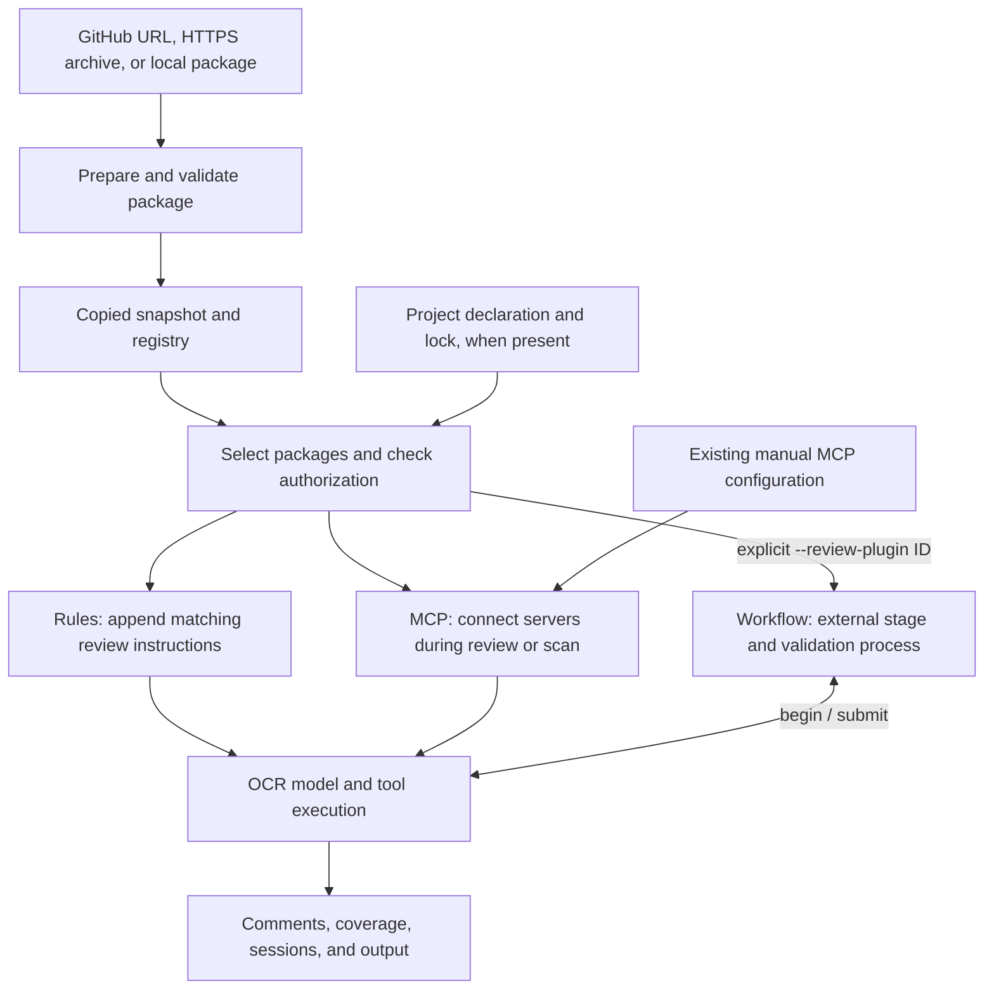
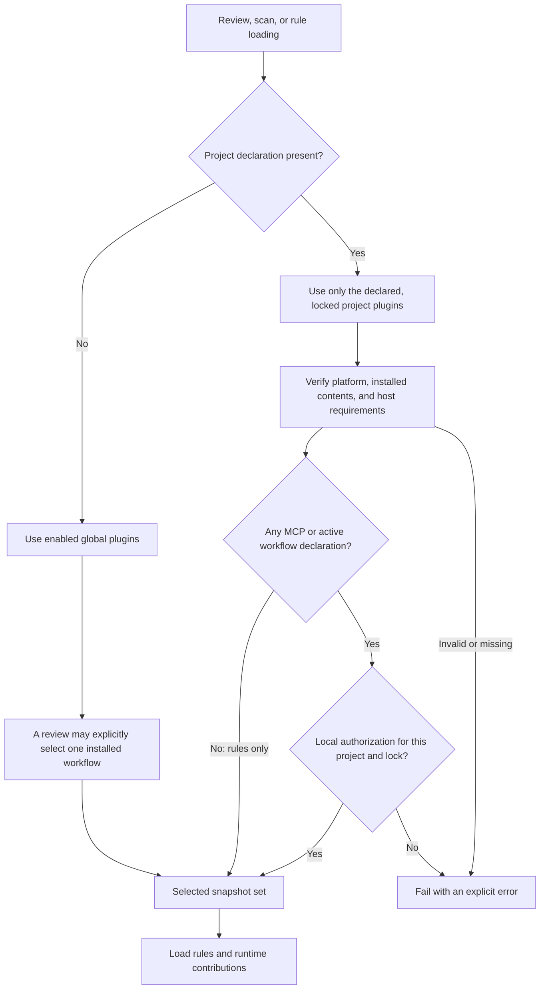
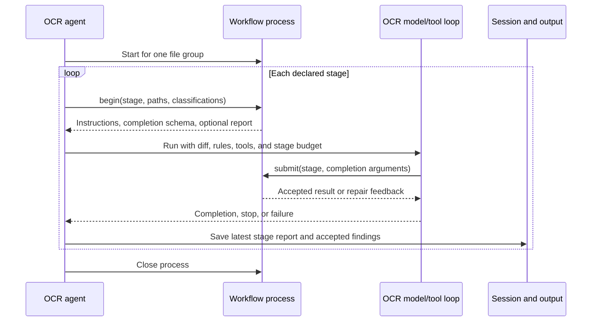

# Native plugin architecture

Native plugins package reusable review rules, MCP server declarations, and
optional review workflows behind `ocr-plugin.json`. A package can contribute
one or more of these capabilities. OCR owns installation, package selection,
authorization checks, and the adapters into its review runtime.

This guide maps the implementation for reviewers. For commands and manifest
fields, see [Native OCR plugins](native-plugins.md). For the workflow wire
protocol, see [Review workflow plugins](review-workflow-plugins.md).

## Package lifecycle and runtime

The arrows below follow package data into the runtime. Installation and frozen
sync produce copied snapshots; a review loads the selected snapshots before
starting executable contributions.

| Contribution | Package owns | OCR owns | Activation |
| --- | --- | --- | --- |
| Rules | Rule JSON and referenced text | Existing rule priority, file matching, and appended plugin rules | Enabled global package or selected project package |
| MCP | Local command or remote endpoint, arguments, environment, headers, and tool allowlist | MCP clients, tool registration, and client cleanup | Selected and authorized package during review/scan |
| Workflow | Ordered stages, prompts, completion schema, validation, and process state | Diff/rule context, model/tool loop, budgets, comment handling, and saved reports | `ocr review --review-plugin ID` |

Enabling a global package activates its rules and MCP contributions. It does not
select its workflow. An explicit workflow selection also includes that package's
rules and MCP contributions for the invocation, even if the global package is
disabled. With a project declaration, selection is restricted to the locked set.

## Module boundaries

| Area | Responsibility and boundary | Main entry points |
| --- | --- | --- |
| Package contract | Parse contribution declarations and check host requirements; no process launch | [`manifest.go`](../internal/plugin/manifest.go), [`compatibility.go`](../internal/plugin/compatibility.go) |
| Source preparation | Resolve direct sources, select a package, bound downloads/extraction, validate files, and calculate digests | [`install_source.go`](../internal/plugin/install_source.go), [`github_source.go`](../internal/plugin/github_source.go), [`source.go`](../internal/plugin/source.go), [`package.go`](../internal/plugin/package.go), [`tar.go`](../internal/plugin/tar.go) |
| Installed state | Copy snapshots, commit registry updates, enable/disable/remove packages, and compare update execution declarations | [`store.go`](../internal/plugin/store.go), [`update.go`](../internal/plugin/update.go); [`legacy_source.go`](../internal/plugin/legacy_source.go) handles older cached sources |
| Project policy | Resolve declarations into platform locks, sync exact artifacts, verify snapshots, and record local execution authorization | [`project.go`](../internal/plugin/project.go), [`project_sync.go`](../internal/plugin/project_sync.go), [`project_inspection.go`](../internal/plugin/project_inspection.go) |
| Runtime adapters | Load a common selected snapshot set into rules, MCP, and the explicitly selected workflow | [`plugin_rules.go`](../internal/config/rules/plugin_rules.go), [`plugin_runtime.go`](../cmd/opencodereview/plugin_runtime.go), [`review_plugin.go`](../internal/agent/review_plugin.go), [`review.go`](../internal/plugin/review.go) |
| CLI inspection | Parse management commands and render summaries; inspection does not initialize the review runtime | [`plugin_cmd.go`](../cmd/opencodereview/plugin_cmd.go), [`plugin_project_cmd.go`](../cmd/opencodereview/plugin_project_cmd.go), [`mcp_cmd.go`](../cmd/opencodereview/mcp_cmd.go) |
| Results and reuse | Save workflow stage reports; include plugin configuration/content in local resume and CI reuse decisions | [`plugin_report.go`](../internal/session/plugin_report.go), [`resume_identity.go`](../internal/session/resume_identity.go), [`project-plugins.js`](../scripts/github-actions/project-plugins.js), [`action.yml`](../action.yml) |

`internal/plugin` holds package/state operations and the workflow process
transport. Contribution-specific integration lives with the rule resolver, CLI
MCP initialization, and agent execution. The rule resolver's `EnabledPlugins()`
supplies the same selected snapshots to the MCP adapter; `ReviewPlugin()` supplies
the explicitly selected workflow to the agent.

## Selection, installation, and authorization

- `plugin install` copies a global package, disabled by default. `--enable` or
  `plugin enable` makes its rules/MCP contributions available to later runs.
- `plugin add` and `plugin lock` resolve sources and write repository declarations
  and platform locks. They can download packages to inspect them.
- `plugin sync --frozen` installs the exact locked artifacts. It checks recorded
  digests and does not resolve a newer version or authorize execution.
- `plugin trust` records authorization outside the repository, bound to the
  canonical project path, lock, and platform. A changed lock needs a new decision.
- Review and preflight verify installed project contents without downloading
  packages. An invalid project configuration fails instead of choosing global
  plugins. An empty project declaration selects no packaged plugins.

Manual MCP configuration and existing project/user rule files keep their current
behavior. The project declaration selects the packaged contributions only.
Native executable contributions have the user's or runner's permissions; the
installation and trust mechanisms do not sandbox their runtime behavior.

### Read-only management

`mcp list` combines manual server configuration with global or project plugin
declarations. `Project.Inspect` verifies installed project snapshots without
granting or requiring execution authorization, so untrusted snapshots can be
shown as `authorization_required`. Invalid locks, changed/missing snapshots, and
unsupported project requirements still produce errors. Incompatible enabled
global plugins remain visible with an `incompatible` state.

Listing does not connect to MCP endpoints, run setup hooks or credential commands,
or change configuration/trust. `configured` describes the selected declaration,
not connection health. `plugin install SOURCE --dry-run` may download and prepare
the requested source, but does not install, enable, or execute its contributions.

### Updates

Global updates re-read the recorded source and retain the enabled state. Added
or changed execution declarations require `--accept-permissions`; rejection
leaves the previous installation in place. Project updates use a new lock,
frozen sync, and renewed lock authorization. Execution acceptance concerns
declared capabilities; unchanged declarations do not establish trust in updated
program contents. Older snapshots remain available to active runs.

## Workflow execution boundary

The selected workflow uses one native process per file group. It keeps state
between that group's declared stages. OCR drives the existing model/tool loop
and sends completion submissions to the process for validation.

The sequence shows the request lifecycle; incomplete required work or a process/
protocol failure stops the group. Repair feedback can lead to another submission
within the existing allowance. Accepted findings keep OCR's normal validation
and filtering. Saved reports remain inspectable if later work fails; incomplete
required work is reflected in coverage and a nonzero CLI exit. Workflow process
state cannot currently be restored with `--resume`.

The changes in `internal/llmloop` and `internal/llm` provide the completion callback,
stage instructions/schema, and budget handling needed by this adapter. The
workflow protocol is documented separately so those shared-loop changes can be
reviewed against the concrete `begin`/`submit` consumer.

## CI and reusable results

The Action selects rules and plugin policy from the PR base or an explicitly
trusted `policy_sha`. The PR head supplies the code diff. With `project_plugins`
enabled, it creates a private OCR home, runs frozen sync, optionally authorizes
execution through the trusted workflow's `allow_plugin_exec` input, and obtains
a verified fingerprint before review. Model credentials are configured after
plugin preparation. Personal global packages and old trust records are not
inherited into this home.

Local resume identity includes selected manifests, package contents, rule text,
and workflow selection. Executable contributions also retain observable install
paths in that identity. CI reuse uses the trusted policy and verified plugin
fingerprint, including execution permission, without temporary installation
paths. These checks prevent reusing a result after relevant plugin policy changes.

## Suggested review order

| Step | Read together | Question to answer |
| --- | --- | --- |
| 1. Contract | `internal/plugin/manifest.go`, `compatibility.go`, and their tests | Which contributions can a package declare, and how are unsupported requirements rejected? |
| 2. Preparation and storage | `install_source.go`, `github_source.go`, `source.go`, `package.go`, `tar.go`, `store.go`, `update.go`, and their tests | Do supported sources become validated snapshots without executing package code, and do failed updates preserve the old registration? |
| 3. Project selection and trust | `project*.go`, project CLI commands, and project tests | Are locked bytes verified, global fallback prevented, and authorization kept separate from repository declarations? |
| 4. Rules and MCP | `internal/config/rules/plugin_rules.go`, CLI `plugin_runtime.go`, `mcp_cmd.go`, and their tests | Are existing rules/manual MCP preserved, selected snapshots reused consistently, and management reads free of runtime startup? |
| 5. Opt-in workflow | `internal/plugin/review.go`, `internal/agent/review_plugin.go`, shared `llmloop` changes, CLI review/output changes, and workflow tests | Does explicit selection drive the stage protocol while preserving budgets, failure reporting, comment handling, and cleanup? |
| 6. Persistence and CI | Session identity/report changes, `action.yml`, `project-plugins.js`, Action tests, and examples | Is policy taken from a trusted commit, and does a plugin change invalidate reusable results? |

The implementation supports direct package installation and management. The
independently buildable TUI is reviewed separately in PR #1739. Marketplace
catalog/search support is absent; older cached-source migration is contained in
`legacy_source.go`. Follow [the CLI guide](native-plugins.md) to exercise each
path after reviewing its implementation.
