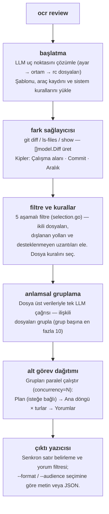
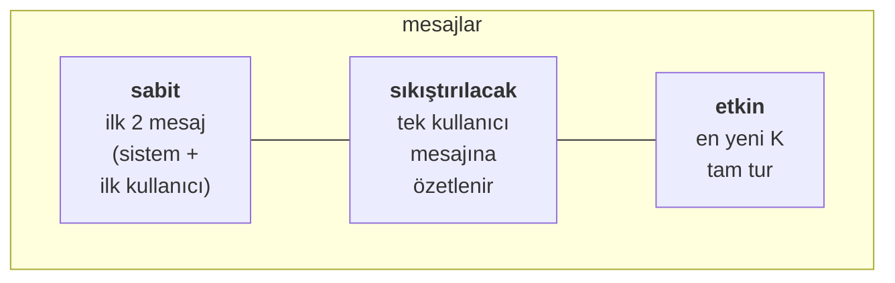

Bu belge, Enter tuşuna bastığınız andan terminale JSON çıktısının ulaşmasına kadar `ocr review` komutunun iç işleyişini anlatır. Amaç; davranışı incelemek, seçenekleri ayarlamak ve kaynak kodu anlamak için gerekli genel çerçeveyi sunmaktır.

## Genel işlem akışı {#high-level-pipeline}



İş akışı [`internal/agent/`](https://github.com/alibaba/open-code-review/tree/main/internal/agent/) paketinde yönetilir. Başlıca dosyalar: `agent.go` (görev dağıtımı ve grup yönetimi), `grouping.go` (anlamsal dosya gruplama), `selection.go` (dosya filtresi), `preview.go` (`--preview` raporu) ve `util.go` (yardımcılar). Araç kullanımı döngüsü ve bellek sıkıştırma, [`internal/llmloop/`](https://github.com/alibaba/open-code-review/tree/main/internal/llmloop/) paketindedir. İki önemli giriş noktası `Agent.Run` (akışın başlangıcı) ve `Agent.dispatchSubtasks` (gruplara görev dağıtımı) yöntemleridir.

## Fark sağlayıcısı {#the-diff-provider}

`internal/diff/git.go`, dışa aktarılmayan `mode` alanı (`int` tabanlı `Mode` numaralandırması) komut satırı seçeneklerine karşılık gelen üç kipten birini seçen bir `Provider` yapısı tanımlar:

| Kip | Etkinleştiren seçenek | Döndürülen değişiklikler |
| --- | --- | --- |
| `Workspace` | Seçenek verilmemesi | İndekse eklenmiş, eklenmemiş ve izlenmeyen değişiklikler |
| `Commit` | `--commit <sha>` / `-c <sha>` | `<sha>` commit'inin getirdiği değişiklikler; `git show <sha>` ile, `<sha>^..<sha>` farkına eşdeğer |
| `Range` | `--from <a> --to <b>` | `merge-base(a, b)..b` |

Her fark; eski/yeni yol, eski/yeni değişiklik parçaları, ekleme/silme sayıları, ikili dosya işareti ve yeniden adlandırma bilgisi taşır. `DiffContextLines`, Git varsayılanıyla aynı olacak şekilde **3** olarak sabittir.

İzlenmeyen dosyalar diskten okunur ve tamamı yeni eklenmiş kabul edilir; böylece commit öncesinde incelenirler.

## Beş aşamalı dosya filtresi {#the-five-gate-file-filter}

Farklar yüklendikten sonra her dosya [`whyExcluded`](https://github.com/alibaba/open-code-review/blob/main/internal/agent/selection.go) işlevinden geçer. İşlev aşağıdaki değerlerden birini döndürür:

```
binary          — file is binary
user_exclude    — matched a pattern in your `exclude` list
unsupported_ext — extension is not in supported_file_types.json
default_path    — matched a built-in exclude pattern
```

Dosya tutulursa boş değer döndürür. `deleted` ve `too_large`, **`whyExcluded` tarafından döndürülmez**; `selectFiles` bunları aşamalardan sonra uygular. Tutulan dosyanın farkı `IsDeleted` bildiriyorsa `deleted`, yalnızca ham farkı `max_tokens` değerinin %80'ini aşıyorsa `too_large` kullanılır. Aşamaların sırası:

1. `binary` — Önce ikili dosyalar dışlanır.
2. `user_exclude` — Projenizin `exclude` kalıpları önceliklidir.
3. `user_include` — Filtrede include kalıpları varsa **ve** dosya bunlardan biriyle eşleşiyorsa hemen tutulur (boş değer döndürülür); sonraki `unsupported_ext` ve `default_path` aşamaları atlanır.
4. `unsupported_ext` — Uzantı izin listesine göre filtreler.
5. `default_path` — Son aşama, yerleşik dışlama kalıplarını uygular. Bunlar test dosyalarını (`**/*_test.go`, `**/__tests__/**`, `**/*_spec.rb` vb.) ve bağımlılık/derleme çıktısı dizinlerini (`**/node_modules/**`, `**/vendor/**`, `**/target/**`, `**/__pycache__/**` vb.) kapsar. Kalıplar `**/` önekiyle köklendirilir.

Aynı dizinler daha erken bir aşamada, fark sağlayıcısında `internal/diff/git.go` içindeki `providerDirIgnoreDirs` listesiyle de filtrelenir. Liste yol önekiyle eşleştiği için yalnızca **depo kökündeki** dizinleri yakalar. `vendor/pkg/x.go` dosya filtresine ulaşmaz; `api/vendor/pkg/x.go` ise ulaşır ve `default_path` tarafından dışlanır.

Bu fark kullanıcıya da yansır: önizleme ilkini `provider_directory` olarak bildirir ve `include` kuralı incelemeye alamaz. İkincisi `default_path` olarak bildirilir ve `include` ile geçersiz kılınabilir.

Token harcamadan tüm filtre sonucunu görmek için `ocr review --preview` çalıştırın. Algoritmanın tamamı için [İnceleme kuralları](../review-rules/#how-files-are-filtered) belgesine bakın.

## Anlamsal dosya gruplama {#semantic-file-grouping}

Filtreyi geçen dosyalar tek tek incelenmez. Görev dağıtımından önce [`grouping.go`](https://github.com/alibaba/open-code-review/blob/main/internal/agent/grouping.go) içindeki `groupDiffs`, yalnızca dosya **üst verilerini** taşıyan tek bir `GROUPING_TASK` LLM çağrısı yapar: yol, durum (`ADDED` / `MODIFIED` / `DELETED` / `RENAMED`) ve ekleme/silme sayıları. Fark içeriği gönderilmez. Model, `{label, files}` nesnelerinden oluşan JSON dizisi döndürür. Her grup ortak bir konuşmada incelenir; böylece ajan ilişkili değişiklikleri birlikte değerlendirebilir (işleyici + servis + test veya yeniden adlandırma ve çağrı noktaları gibi).

Üç koruma uygulanır:

| Koruma | Etkisi |
| --- | --- |
| `maxFilesPerGroup = 10` | Büyük gruplar 10 dosyalık parçalara bölünür. |
| Token bütçesi | Birleşik farkları istem sınırını aşan grup, tek dosyalı gruplara ayrılır. |
| Kapsama | Modelin gruba atamadığı her dosya kendi grubuna yerleştirilir. |

Gruplama, doğruluk için zorunlu bir aşama değil, mümkün olduğunda uygulanan bir iyileştirmedir. Başarısız, boş veya ayrıştırılamayan yanıtta uyarı kaydedilir ve önceki davranış olan dosya başına bir grup düzenine dönülür. Gruplama sonucu JSON çıktısında da yer alır.

## Grup başına alt görev: planlama ve ana döngü {#per-group-subtask-plan-main}

OCR her grup için bir alt ajan başlatır. Her alt ajan ayrı bir goroutine içinde çalışır; eşzamanlılık `--concurrency` ile sınırlandırılır (varsayılan **8**). Her birinin kendi LLM mesaj tamponu vardır.

Alt görev en fazla **iki aşamadan** oluşur:

### 1. aşama — Planlama (isteğe bağlı) {#phase-1-plan-optional}

Planlama aşamasını, iki eşiği birlikte değerlendiren `Template.PlanRequired` belirler:

```go
// PLAN_MODE_LINE_THRESHOLD = 50, PLAN_MODE_GROUP_LINE_THRESHOLD = 100
if maxFileChanged >= PlanModeLineThreshold           { plan }  // one big rewrite
if fileCount >= 2 && total >= PlanModeGroupLineThreshold { plan }  // several moderate files
```

Dosya eşiği tek büyük yeniden yazımı; grup eşiği, birlikte ele alındığında yapılandırılmış yönlendirme gerektiren orta büyüklükteki dosyaları yakalar. Çok dosyalı gruplarda planlamanın koşulsuz çalışmaması için grup eşiği daha yüksektir.

Küçük değişikliklerde planlama yalnızca gecikme eklediğinden sessizce atlanır ve ana döngü başlar. Diğer durumlarda OCR **tek** bir `PLAN_TASK` LLM çağrısı yapar. `Tools` alanı gönderilmez, dolayısıyla model planlama sırasında araç çağıramaz. Salt okunur araç alt kümesi (`code_search`, `file_read`, `file_read_diff`, `file_find`; `task_template.json` içindeki `PLAN_TASK.tool_references` ile seçilir), modelin sonraki aşamada nelerin kullanılabileceğini bilmesi için `{{plan_tools}}` yer tutucusuna `formatToolDefs` tarafından düz metin olarak eklenir. Dönen kontrol listesi, ana istemde `{{plan_guidance}}` olur.

### 2. aşama — Ana döngü {#phase-2-main-loop}

Ana döngü `MAIN_TASK` istemini oluşturur ve modelle araç kullanan bir konuşma yürütür. Tam araç kümesi, planlama araçlarına **`task_done`** ve **`code_comment`** ekler. Tam liste için [Araçlar](../tools/) belgesine bakın.

```
loop up to MAX_TOOL_REQUEST_TIMES (default 100):
    response = llm.complete(messages, tools)
    if response.toolCalls is empty:
        nudge model with "You did not successfully call any tools.
                          Please try again or use task_done if finished."
        continue
    for each call: execute → collect result
    if any call was task_done: break
    addNextMessage(...)              # may trigger compression
```

Döngü beş koşuldan biriyle sona erer:

1. `task_done` çağrılır.
2. `MAX_TOOL_REQUEST_TIMES` sınırına ulaşılır.
3. Art arda 3 turda geçerli araç sonucu oluşmaz (`maxConsecutiveEmptyRounds = 3`).
4. Bağlam iptal edilir.
5. Sıkıştırma mesaj tamponunu uyarı eşiğinin altına indiremediği için `addNextMessage` false döndürür.

Her durumda biriken `code_comment` çağrıları inceleme yorumlarına dönüşür.

### İnceleme turları {#review-rounds}

Büyük gruplarda daha fazla bulgu yakalamak için ana döngü grup başına `MAX_REVIEW_ROUNDS` kez çalışabilir. Tur sayısını `--effort` ön ayarı belirler:

| `--effort` | Tur sayısı |
| --- | --- |
| `low` | 1 |
| `medium` (varsayılan) | 2 |
| `high` | 3 |

İlk turdan sonraki her tur, önceki turlarda doğrulanan bulguları `{{confirmed_comments}}` olarak ekleyerek `MAIN_TASK` görevini yeniden çalıştırır. Plan **eklenmez**; belirgin sorunlar bulunduktan sonra plan, incelemenin kapsamını sınırlayabilir. Yeni bulgu çıkmadığında, doğrulanmış yorum sınırına ulaşıldığında veya toplam token bütçesi (`--max-tokens-budget`) tükendiğinde turlar erken sonlanır.

## Bellek sıkıştırma {#memory-compression}

Uzun araç kullanımı döngüleri sonunda bağlam penceresini aşabilir. OCR bunu, `MAX_TOKENS = 200000` ile tanımlanan istem bütçesine göre tetiklenen **üç bölgeli bölümleme** yöntemiyle yönetir:

| Eşik | Sabit | İşlem |
| --- | --- | --- |
| MAX_TOKENS değerinin %60'ı | `tokenSoftThreshold` | Arka planda **asenkron** sıkıştırmayı başlatır; döngü kesintisiz sürer. |
| MAX_TOKENS değerinin %80'i | `tokenWarningThreshold` | Sonraki istekten önce **senkron** sıkıştırma yapar. |

> **`MAX_TOKENS` bir girdi sınırıdır.** Yalnızca istemi, yani mesaj tamponunun sıkıştırıldığı bağlam bütçesini sınırlar. Modelin çıktı sınırı ayrı bir ayardır: `MAX_COMPLETION_TOKENS = 16384` (`Template.CompletionTokenLimit()`). Bu ayrım, büyük bağlamlı model için `--max-tokens` artırıldığında çıktı bütçesinin de fark edilmeden artmasını önler. Geriye uyumluluk için `MAX_COMPLETION_TOKENS` ayarlanmamışsa çıktı sınırı olarak `MAX_TOKENS` kullanılır.

OCR, etkin turları seçmeden önce **görünür özet** için yer ayırır. Ayrılan alan üç sınırdan en küçüğünü aşamaz: yapılandırılmış çıktı sınırı, bağlamın %20'si ve sabit istemle özeti çevreleyen etiketlerden arta kalan alan. Bazı sağlayıcılar akıl yürütme tokenlarını da çıktıdan sayar. Sıkıştırma isteği %80 uyarı eşiğinin altında kalıyorsa OCR, yapılandırılmış çıktı sınırına kadar daha büyük bir üretim bütçesi isteyebilir; ancak modelden görünür özeti ayrılan alana sığdırmasını ister. Yeniden oluşturulan geçmiş yine sınıra sığmalıdır. Bu sınırlar toplam `--max-tokens-budget` değerinden bağımsızdır; bu değeri sıfırlamak bağlam sıkıştırmasını kapatmaz.

### Üç bölge {#the-three-zones}



Bir “tur”, bir asistan mesajı ve ardından gelen araç sonuçlarıdır. `partitionMessages`, turları sondan başa tarar ve toplamı `(0.80 × MAX_TOKENS) - reservedTokens` değerinin kesin olarak altında tutar. Ayrılan alan ilk iki mesajı (önceki özetler dahil), görünür özeti ve etiketlerini kapsar. Daha eski mesajlar **sıkıştırılacak bölgeyi** oluşturur; bu bölge boşsa konuşma değişmez. Bütçeye, asistan mesajları ve araç sonuçlarının yanı sıra turlar arasındaki yeniden deneme talimatları da dahildir. Uyarı eşiğinin altındayken arka plan işlemi güncel geçmişin tamamını özetlemez. Eşiğe ulaşıldığında veya eşik aşıldığında en son tur bile özete ayrılan alanla birlikte sığmıyorsa özetlenebilir.

Bu bölge XML'e dönüştürülür ve `MEMORY_COMPRESSION_TASK` istemiyle modele gönderilir. Dönen özet, özgün kullanıcı mesajına `<previous_review_summary>` etiketleri içinde eklenir.

Sıkıştırma sonrasında: `messages = system + (original_user + summary) + active`. Yeni konuşma aynı yerel token tahminiyle ölçülür ve özgün konuşmadan daha küçük olmalıdır. Sıkıştırma şablonu eksikse, özet boşsa veya sonuç küçülmediyse özgün geçmiş korunur. Yalnızca görünür özet kullanılır; modelin akıl yürütmesi tek başına geçmişin yerini almaz. Yanıt çıktı sınırında kesilmişse, özet şablonu kullanılamıyorsa veya yeniden oluşturulan konuşma sınırı aşıyorsa hiçbir özgün mesaj silinmeden hata döndürülür.

### Asenkron ve senkron çalışma {#async-vs-sync}

Asenkron yolda sıkıştırma arka planda sürerken ana döngü araç çağırmaya devam eder. Sonraki token kontrolünde hazır özet `tryApplyPendingCompression` ile uygulanır. Asenkron iş tamamlanmadan uyarı eşiği aşılırsa döngü bekler ve `runCompression` senkron çalışır. Arka plan işlemi için geçmişin kopyası alındıktan sonra eklenen mesajlar, özet uygulandığında korunur. Konuşma hâlâ yerel uyarı eşiğinin altına inmiyorsa döngü `StopCompression` ile durur; sıkıştırılmamış geçmişi sessizce silmez. Yerel tahmin, sağlayıcının gerçek bağlam penceresine sığılacağını garanti etmez.

## Yorum işleme akışı {#comment-processing-pipeline}

Her `code_comment` çağrısı bir veya daha fazla ham yorum üretir. Ana araç döngüsünün son işleme nedeniyle beklememesi için yorumlar sabit boyutlu bir goroutine havuzundan, **CommentWorkerPool** üzerinden geçirilir:

1. **Satır belirleme** (işçi içinde) — `existing_code`, kayan pencere algoritmasıyla farkta aranır; `start_line` / `end_line` belirlenir. Eşleşme yoksa ikisi de `0` olur. `0`, kullanıcının yerini elle bulması gereken konumlandırılmamış yorumun örtük işaretidir; ayrı bir bayrak saklanmaz, tüketiciler `start_line == 0` kontrolü yapar.
2. **Yeniden konumlandırma** (isteğe bağlı yedek yol) — Basit olmayan bir farkta satır belirleme başarısızsa `RE_LOCATION_TASK`, modelden parçayı yeniden konumlandırmasını ister. Bu, `existing_code` metni farklı sözcüklerle ifade edildiğinde yararlıdır.
3. **İnceleme filtresi** — Ana döngü ve işçi havuzu tamamlandıktan sonra `REVIEW_FILTER_TASK`, yorumları farkla karşılaştırır ve yanlış olduğu kanıtlanabilenleri kaldırır. Buradaki hatalar kaydedilir ve yok sayılır.
4. **İkinci satır belirleme geçişi** — `Agent.Run` döndükten sonra üst düzey komut tüm yorumlarda `diff.ResolveLineNumbers` çalıştırır (`cmd/opencodereview/review_cmd.go`). Birden fazla dosyaya yayılan veya yeniden konumlandırmada güncellenmiş `existing_code` parçaları böylece yakalanır.
5. **Çıktı oluşturma** — `--format` seçimine göre metin veya JSON üretir.

## Token bütçesi korumaları {#token-budget-guards}

OCR, LLM'i çağırmadan önce erken bir sınır kontrolü yapar:

```go
tokenLimit := MaxTokens * 4 / 5     // 80 %
if countMessagesTokens(messages) > tokenLimit {
    record warning "token_threshold_exceeded"
    return nil      // skip this group
}
```

Bu kontrol, çok büyük farkları (otomatik üretilmiş kilit dosyaları, binlerce satırlık yeniden düzenlemeler) istek maliyeti oluşmadan yakalar. Atlanan grup stdout üzerinde işlemi durdurmayan uyarı olarak bildirilir ve JSON `warnings` dizisine eklenir.

İkinci kontrol `selectFiles` içinde çalışır: farkın kendisi `MAX_TOKENS` değerinin %80'ini aşarsa gruplama ve görev dağıtımından önce `too_large` olarak dışlanır. Üçüncü koruma gruplama içindedir; yukarıdaki `enforceGroupTokenBudget` açıklamasına bakın.

## Şablon ve yer tutucular {#the-template-placeholders}

`internal/config/template/task_template.json` **altı istem** içerir:

| Anahtar | Amaç |
| --- | --- |
| `GROUPING_TASK` | Değişen dosyaları anlamsal gruplara ayırır. |
| `PLAN_TASK` | Planlama aşamasında kontrol listesi üretir. |
| `MAIN_TASK` | Ana inceleme döngüsünde `code_comment` çağrıları üretir. |
| `MEMORY_COMPRESSION_TASK` | Sıkıştırılacak bölgeyi özetler. |
| `REVIEW_FILTER_TASK` | Döngü sonrasında yanlışlığı kanıtlanabilen yorumları kaldırır. |
| `RE_LOCATION_TASK` | `existing_code` eşleştirilemeyen yorumu yeniden konumlandırır. |

Her istem, şablon dizinindeki `.md` dosyalarını gösteren `{role, prompt_file}` başvurularından oluşur (ör. `{"role": "system", "prompt_file": "main_task_system.md"}`). Yüklenirken `resolveConversation`, bu dosyaları bellekte `{role, content}` mesajlarına dönüştürür. Ardından yer tutucular grup bazında çözümlenir:

| Yer tutucu | Yerine konan içerik |
| --- | --- |
| `{{system_rule}}` | Dört katmandan çözümlenen, grubun dosyaları için birleştirilen kural metinleri. |
| `{{change_files}}` | PR'da bu grubun dışındaki tüm değişen dosyaların durumu ve yolu. |
| `{{diffs}}` | Dosya başına bir XML öğesiyle grubun farkları. |
| `{{plan_guidance}}` | Planlama çıktısı; plan atlandığında veya 2. ve sonraki turlarda kaldırılır. |
| `{{confirmed_comments}}` | Önceki turlarda doğrulanan bulgular; ilk turda boştur. |
| `{{plan_tools}}` | `formatToolDefs` tarafından düz metne dönüştürülen planlama araçları; `PLAN_TASK` sistem isteminde kullanılır. |
| `{{requirement_background}}` | `--background` veya `--background-file` ile sağlanan bağlam; dosya önceliklidir. |
| `{{current_system_date_time}}` | Çalıştırmanın yerel tarih ve saati; `YYYY-MM-DD HH:MM`, saniye ve saat dilimi olmadan. |
| `{{file_list}}` | Yalnızca gruplamada: dosya yolu, durum ve `+/-` sayıları. |
| `{{context}}` | Yalnızca sıkıştırmada: özetlenecek XML mesajları. |
| `{{path}}` | `REVIEW_FILTER_TASK` için grup anahtarı; sıralı yolların virgülle birleşimi. |
| `{{comments}}` | `REVIEW_FILTER_TASK` için biriken yorumlar (JSON). |

Yer tutucu değiştirme [`agent.go`](https://github.com/alibaba/open-code-review/blob/main/internal/agent/agent.go) içindedir. Şablon komut satırından değiştirilemez; istemleri değiştirmek için [`task_template.json`](https://github.com/alibaba/open-code-review/blob/main/internal/config/template/task_template.json) düzenlenip yeniden derlenir. Yerleşik araç tanımları da gömülüdür ve çalışma anında değiştirilemez. Proje yönlendirmesi için inceleme kurallarını ve bağlamı, dış iş bağlamı için MCP'yi kullanın; bkz. [Araçlar](../tools/#customizing-tools).

> **Yer tutucu sözdizimi:** Yukarıdakiler `{{…}}` biçiminde çift süslü parantez kullanır. Tek istisna `RE_LOCATION_TASK` görevidir; `{diff}`, `{existing_code}` ve `{suggestion_content}` kullanır (`internal/diff/relocation.go`).

## Kalıcı kayıt {#persistence}

Her inceleme JSONL olarak diske yazılır:

```
~/.opencodereview/sessions/<encoded-repo-path>/<session-id>.jsonl
```

Depo yolu base64 ile kodlanmaz. `internal/session/persist.go` içindeki `encodeRepoPath`, dosya sistemi için güvenli bir yol üretmek üzere `/` ve `\` karakterlerini `-`, `:` karakterini `_` ile değiştirir.

Her satır bir olaydır: gönderilen istem, LLM yanıtı, araç çağrısı, araç sonucu, üretilen yorum vb. Web arayüzü (`ocr viewer`) dosyaları doğrudan okur. Veritabanı yoktur; yalnızca sonuna ekleme yapılan günlükler vardır. Arayüz ve olay şeması için [Oturum görüntüleyicisi](../viewer/) belgesine bakın.

## Telemetri {#telemetry}

Telemetri etkinse ajan üç tür işlem akışı span'i üretir: tüm işi kapsayan `review.run`, fark yüklemeyi kapsayan `diff.parse` ve incelenen her grup için `subtask.execute.group.<group-key>`. Ayrıca karar noktalarında kısa ömürlü `event.<name>` span'leri oluşur (`plan.skipped`, `token.threshold.exceeded`, `subtask.error` vb.). Ana döngüde LLM istekleri ve araç çağrıları da span üretir ve metriklere kaydedilir. İstem ve yanıt içeriği telemetriye **asla** eklenmez; `OCR_CONTENT_LOGGING` bayrağı tanımlıdır ancak şu anda etkisizdir. Tam şema için [Telemetri](../telemetry/) belgesine bakın.

## Otomatikleştirilmeyen işlemler {#what-s-not-automated}

Bazı kararlar bilinçli olarak elle verilir:

- **Uç nokta keşfinde yedek seçim yapılmaz.** Yapılandırma, ortam değişkenleri ve rc dosyalarından eksiksiz `(URL, token, model)` üçlüsü bulunamazsa OCR tahmin etmek yerine sıfırdan farklı kodla çıkar.
- **Alt ajan hataları yalıtılır; yeniden denenmez.** Başarısız grup uyarı üretirken diğerleri devam eder. Yeniden denemeler ajanda değil, onu çalıştıran CI akışında yönetilir.
- **Dosyalar arası değerlendirme grupla sınırlıdır.** Aynı anlamsal gruptaki dosyalar ortak LLM konuşmasını paylaşır. Diğer gruplara yalnızca `file_read_diff` / `code_search` araçlarıyla erişilir; ortak bağlam paylaşılmaz. Bu dosyalar yorum hedefi olamaz: `main_task`, bağlam araçlarını yalnızca anlamak için kullanmayı ve verilen farkların dışında ortaya çıkan sorunları dikkate almamayı söyler.

Bu tercihler, grup başına akışın belirli kurallarla yürütülmesini ve maliyetin öngörülebilir kalmasını sağlar.

## Kaynak kod haritası {#source-code-map}

Kodu incelemek için:

| Konu | Dosya |
| --- | --- |
| Üst düzey komut yönlendirme | `cmd/opencodereview/main.go` |
| `review` seçeneklerini ayrıştırma | `cmd/opencodereview/shared_flags.go` |
| Ajan yönetimi | `internal/agent/` (agent.go, util.go) |
| Anlamsal dosya gruplama | `internal/agent/grouping.go` |
| Araç döngüsü ve bellek sıkıştırma | `internal/llmloop/` (loop.go, compression.go) |
| İnceleme çabası ön ayarları | `internal/config/template/effort.go` |
| Dosya filtresi / önizleme | `internal/agent/selection.go`, `internal/agent/preview.go` |
| Fark yükleme (Git kipleri) | `internal/diff/git.go` |
| Kural çözümleme sırası | `internal/config/rules/system_rules.go` |
| Araç kaydı ve uygulamaları | `internal/tool/` |
| LLM uç nokta çözümleyicisi | `internal/llm/resolver.go` |
| Oturum JSONL yazıcısı | `internal/session/persist.go` |
| Web görüntüleyicisi | `internal/viewer/server.go` |

Derleme ve test için [Katkıda bulunma](../contributing/) belgesine bakın.

## Ayrıca bkz. {#see-also}

- [Araçlar](../tools/) — Ajan döngüsünün çağırdığı altı araç.
- [İnceleme kuralları](../review-rules/) — Dosya başına kural metninin çözümlenmesi.
- [Oturum görüntüleyicisi](../viewer/) — Bu akışın kaydettiği konuşmaları inceleme.
